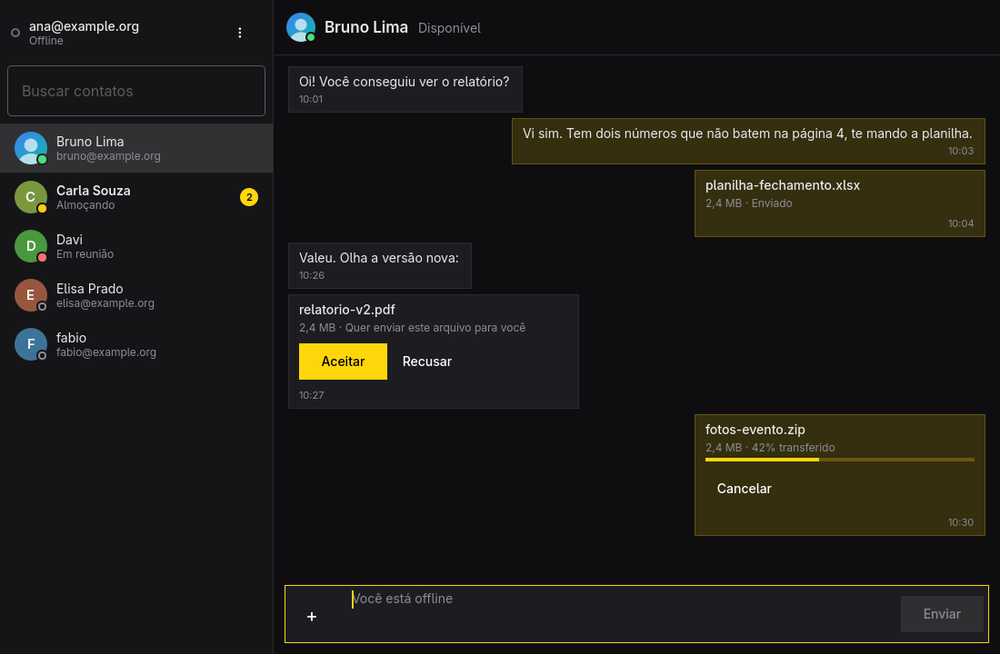

# Omajim



Cliente XMPP para o [Omarchy](https://omarchy.org), feito em C++ e Qt Quick
sobre a biblioteca [QXmpp](https://github.com/qxmpp-project/qxmpp). Uma
janela: seus contatos à esquerda e a conversa à direita.

- Conversas 1:1 com histórico local (SQLite), notificações na área de
  trabalho e cópia das mensagens enviadas de outros dispositivos (carbons).
- A barra lateral mostra só as conversas abertas, a mais recente no topo,
  com o trecho da última mensagem, como no Gajim. A busca (Ctrl+K ou
  Ctrl+T) passa por todos os contatos e salas, de forma aproximada ("jcp"
  acha "Jean Carlos Pereira", sem ligar para acentos), e Enter com um endereço completo começa
  uma conversa nova. Ctrl+W fecha a conversa; o histórico fica, e uma
  mensagem nova a abre de novo.
- Apelido local (clique direito → "Definir apelido…"): um nome só neste
  computador, que aparece em todo lugar no lugar do nome do servidor, sem
  alterá-lo. Vazio volta ao nome do servidor.
- A lista de contatos fica guardada e aparece na hora ao abrir, antes de
  conectar; o servidor só manda o que mudou (roster versioning).
- Importa o histórico do Gajim (e do Omajim em Python) pelo menu ⋮: lê uma
  cópia do `logs.db`, sem alterar o original, traz só a conta conectada e
  não repete mensagens que já estão aqui.
- Shift+clique seleciona mensagens inteiras, da última clicada até a atual
  (Shift+clique numa selecionada a tira), e Ctrl+C copia todas como
  "[data hora] Nome: texto". Esc limpa a seleção.
- Links clicáveis nas mensagens, e prévia das imagens: as que você envia ou
  baixa, e as que chegam pelo servidor de contatos e salas conhecidos, até
  10 MB. Imagens de quem não está nos contatos não são baixadas sozinhas,
  para não revelar o seu endereço.
- Histórico do servidor (MAM, XEP-0313): ao conectar, busca o que chegou
  enquanto o Omajim estava fechado ou passou por outro dispositivo, e avisa
  numa só notificação. Na primeira conexão de uma conta, traz só as 100
  mensagens mais recentes.
- Avatares dos contatos (vCard, XEP-0054/0153), guardados em cache e
  baixados de novo só quando o contato troca de foto.
- Recibos de entrega (XEP-0184): um ✓ ao lado do horário quando o outro
  lado confirma que recebeu. E "digitando…" (XEP-0085) no cabeçalho da
  conversa; o Omajim só avisa que você está digitando para quem também
  manda esse aviso.
- Salas de grupo (MUC, XEP-0045): Ctrl+J entra numa sala, que fica salva
  nos favoritos do servidor (XEP-0402) e volta nos outros dispositivos. As
  salas ficam no topo da lista, cada mensagem mostra o apelido de quem
  escreveu, e só notificam quando alguém escreve o seu apelido ou manda uma
  mensagem privada. Convites aparecem na lista de contatos.
- Arquivos de dois jeitos, escolhidos no botão "+":
  - **pelo servidor** (HTTP Upload, XEP-0363), como o Gajim e o
    Conversations: funciona em salas e com quem está offline. Ctrl+O, ou
    arraste o arquivo para a conversa. Os arquivos que chegam assim aparecem
    com um botão "Baixar";
  - **direto** (SI, XEP-0096), compatível com o Pidgin, por conexão direta
    (SOCKS5) ou pelo servidor (IBB). Ctrl+Shift+O.

  Os arquivos recebidos vão para a pasta de Downloads e só ganham o nome
  final quando estão completos. Um arquivo que já existe nunca é
  substituído.
- A senha fica no chaveiro da sessão (Secret Service, via `secret-tool`),
  nunca num arquivo de configuração.
- Visual dos apps do Omarchy, no estilo do [Hype](https://github.com/omacom/hype):
  usa a paleta inteira do tema atual (fundo, texto, destaque, seleção), a
  fonte do sistema, o arredondamento das janelas do Hyprland e o idioma
  escolhido em Setup > Language, tudo ao vivo.
- Certificados autoassinados: o Omajim mostra a impressão digital SHA-256 e
  só se autentica depois que você confia no certificado.
- Fica na bandeja: fechar a janela só a esconde e o Omajim continua
  recebendo mensagens (Ctrl+Q sai de vez). O item de bandeja usa o mesmo id
  do Omajim em Python, então o widget `omajim.status` da barra do Omarchy
  mostra o status e as mensagens novas, abre a janela com um clique e traz o
  menu de status com o botão direito. Sem bandeja, fechar a janela fecha o
  app.
- Abrir o `omajim` de novo traz a janela que já está aberta, em vez de
  iniciar uma segunda cópia.

Esta é a reescrita do Omajim. O cliente anterior, em Python e GTK e baseado
no Gajim, continua na branch `main`.

## Atalhos

| Tecla | Ação |
| --- | --- |
| Ctrl+K ou Ctrl+T | Buscar contatos (Enter abre a conversa) |
| Alt+↑ / Alt+↓ (ou Ctrl+Tab) | Conversa anterior ou seguinte |
| Enter | Enviar a mensagem |
| Shift+Enter | Nova linha na mensagem |
| Ctrl+O | Enviar um arquivo pelo servidor |
| Ctrl+Shift+O | Enviar um arquivo direto (SI) |
| Ctrl+N | Adicionar um contato |
| Ctrl+J | Entrar numa sala |
| Ctrl+W | Fechar a conversa (tira da barra lateral) |
| ? (fora do campo de texto), F1 ou Ctrl+/ | Mostrar os atalhos |
| ↑ (campo vazio) | Corrigir a última mensagem |
| Shift+clique | Selecionar mensagens inteiras |
| Ctrl+C (com seleção) | Copiar as mensagens selecionadas |
| Ctrl+Q | Sair |

Num app de chat quase sempre se está digitando, então os atalhos usam um
modificador. A exceção é o `?`, que mostra os atalhos como nos outros apps
do Omarchy, mas só quando o foco não está num campo de texto.

## Firewall para o envio direto

No envio direto, quem recebe se conecta no computador de quem envia, na
porta TCP 28011 (a mesma do Omajim em Python). Com o `ufw` ativo, como no
Omarchy, essa porta vem bloqueada e a transferência falha com uma mensagem na
janela. Libere a porta na máquina que envia, de preferência só para a rede
local (troque a faixa pela da sua rede):

```sh
sudo ufw allow from 192.168.0.0/24 to any port 28011 proto tcp
```

Se outro programa estiver usando a 28011, o Omajim escuta numa porta livre
qualquer, e aí a regra acima não vale.

Antes de cada envio direto, o Omajim lê as regras do `ufw` (sem precisar de
root) e, se a porta estiver bloqueada para a sua rede, não a oferece: manda
pelo proxy de bytestreams do servidor, que ele descobre ao conectar, ou,
sem proxy, pelo próprio XMPP (IBB), mais lento mas que sempre passa. O
cartão do arquivo mostra o caminho usado (conexão direta, proxy ou IBB), e
uma notificação avisa quando um arquivo direto termina de chegar.

## Desenvolvimento

Precisa de `qt6-base`, `qt6-declarative`, `qt6-wayland`, `qxmpp` e
`libsecret`.

```sh
bin/build          # compila em build/omajim
bin/test           # roda os testes offscreen
bin/install        # gera e instala o pacote (substitui o omajim-git)
```

Para compilar sem instalar o `qxmpp`, aponte `QXMPP_ROOT` para o pacote
extraído (o diretório que contém `usr/`) e rode com `LD_LIBRARY_PATH`
apontando para `$QXMPP_ROOT/usr/lib`.

Os dados ficam em `~/.config/omajim/omajim.conf` e
`~/.local/share/omajim/accounts/<conta>/history.sqlite`, separados dos
arquivos do Omajim em Python.
